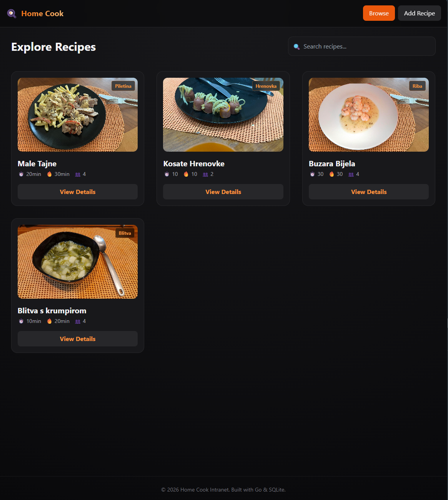
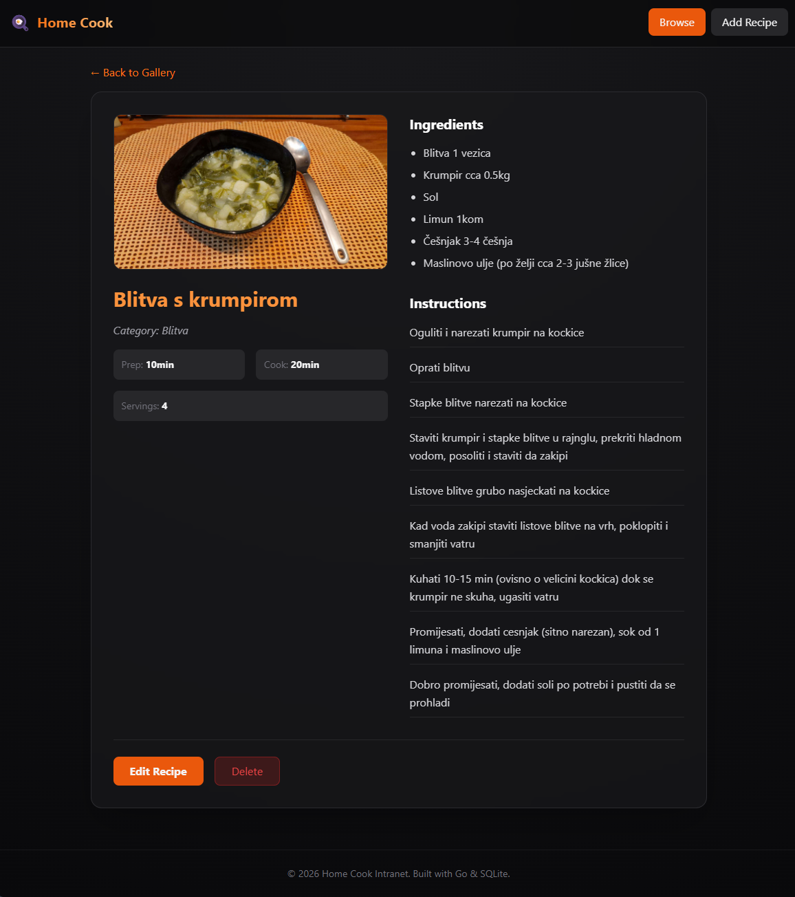
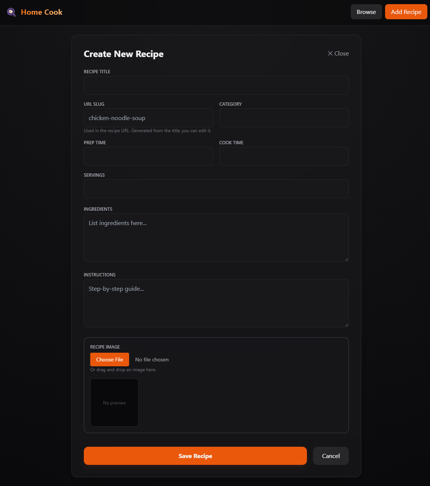

# Home Cook

## AI
this is almost entire Vibe coding project(I had to test it)

## Screenshots

### Home page



### View recipe



### Add recipe



## Configuration

| Environment Variable | Default | Description |
|---------------------|---------|-------------|
| `DNS` | `192.168.1.53` | Upstream DNS server for custom resolution |
| `PORT` | `8080` | HTTP listen port |
| `WWW_DIR` | `/www` | Static file directory for website |

`DNS` accepts an IP address (using port 53) or an IP address with a port, such as
`192.168.1.53:5353`, and is used for Go DNS lookups. Files in `WWW_DIR` are
served from the site root (for example, `img/favicon.ico` is available at
`/img/favicon.ico`); uploaded images are saved in its `upload/` subdirectory
and served at `/upload/`.
When `WWW_DIR` is unset, the server uses `/www` if it contains `index.html`,
otherwise it uses the local `./www` directory if available.
The home page is served at `http://localhost:8080/` by default (or
`http://localhost:<PORT>/` when `PORT` is set).

## Frontend assets

The site uses a static Tailwind CSS stylesheet at `www/css/tailwind.css`; it is
served directly at `/css/tailwind.css`. No Node.js installation or CSS build
step is needed to run the Go server. Other stylesheets are in `www/css/`, and
JavaScript files are in `www/js/`.

## Build

The SQLite driver is pure Go, so no C compiler or CGO setup is needed. To build
the Linux/amd64 executable from Windows PowerShell:

```powershell
$env:GOOS="linux"; $env:GOARCH="amd64"; $env:CGO_ENABLED = "0"; go build -ldflags="-s -w" -trimpath -o app/homeCookingServer main.go
```

To build a Windows executable instead:

```powershell
$env:GOOS = "windows"
$env:GOARCH = "amd64"
go build -ldflags="-s -w" -trimpath -o app/homeCookingServer.exe main.go
```

## Endpoints

## Docker Deployment

### docker-compose.yml (your setup with busybox)

```yaml
version: "1.0"

services:
  checker:
    image: busybox:latest
    container_name: homecook
    restart: always
    network_mode: host
    working_dir: /app
    volumes:
      - /share/Container/HomeCook:/app
    dns:
      - 192.168.1.53
      - 1.1.1.1
    environment:
      PORT: "8075"
      DNS: "192.168.1.53"
      WWW_DIR: "/app/www"
    entrypoint: ["/app/entrypoint.sh"]
```

> Build the Linux executable using the PowerShell instructions above. Copy
> `app/homeCookingServer` to `/share/Container/HomeCook/app/homeCookingServer`
> on the Docker host. The volume maps that location to `/app/app/homeCookingServer`,
> which the entrypoint checks. Then run:
> ```bash
> chmod +x /share/Container/HomeCook/app/homeCookingServer
> docker compose up -d --force-recreate
> ```

### entrypoint.sh (for busybox)

```bash
#!/bin/sh
set -e

echo "[GO] Starting Home Cooking Server..."

if [ -x /app/homeCookingServer ]; then
    exec /app/homeCookingServer
elif [ -x /app/app/homeCookingServer ]; then
    exec /app/app/homeCookingServer
fi

echo "[ERROR] Executable not found. Expected /app/homeCookingServer or /app/app/homeCookingServer." >&2
echo "[ERROR] Place the Linux homeCookingServer binary in the mounted host directory and ensure it is executable." >&2
exit 127
```

Make it executable:
```bash
chmod +x entrypoint.sh
```

## License

MIT